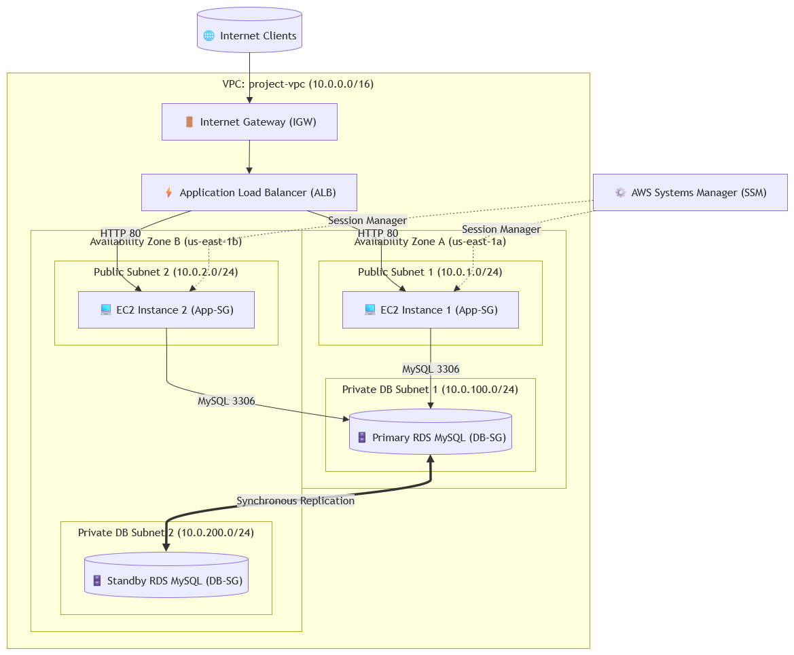

# Scalable Web Application Architecture on AWS

An enterprise-grade, high-availability, fault-tolerant, and cost-optimized web application deployed on Amazon Web Services (AWS). This project demonstrates a production-style deployment using an Application Load Balancer (ALB), Auto Scaling Group (ASG), and Multi-AZ Relational Database Service (RDS) engineered to run within the **AWS Free Tier ($0 operational cost)**.

---

## 📐 Solution Architecture Diagram



---

## 🌟 Key Architecture Highlights

* **High Availability & Fault Tolerance:** Multi-AZ deployment across two Availability Zones (`us-east-1a` and `us-east-1b`) for compute (EC2) and database (RDS) layers.
* **Cost Optimization ($0 Free Tier):** Designed without paid AWS NAT Gateways to completely avoid hourly usage charges. Instances use public subnets with auto-assigned IPv4 addresses for outbound patching, protected strictly by Security Groups.
* **Tiered Security Isolation:** 
  * **Application Tier:** Blocks direct public web traffic (`0.0.0.0/0`) at the firewall level. Accepts HTTP traffic **exclusively** from the Application Load Balancer security group (`ALB-SG`).
  * **Database Tier:** Stored in isolated private subnets with no public internet access, accepting connections strictly from the Application tier (`App-SG`) on port `3306`.
* **Auto Healing & Elasticity:** Dynamic target-tracking Auto Scaling policy maintains desired instance capacity, automatically replacing failed or unresponsive nodes.
* **Secure Bastionless Management:** Administrative terminal access managed via AWS Systems Manager (SSM) Session Manager without opening inbound SSH port 22 or managing SSH keys.

---

## 🛠️ Architecture & Networking Details

### 1. Networking Infrastructure (`project-vpc`)
* **VPC CIDR:** `10.0.0.0/16`
* **Public Subnets:**
  * `Public Subnet 1`: `10.0.1.0/24` (AZ-A / `us-east-1a`) — Hosts ALB & Auto Scaling EC2 Instances
  * `Public Subnet 2`: `10.0.2.0/24` (AZ-B / `us-east-1b`) — Hosts ALB & Auto Scaling EC2 Instances
* **Private Subnets (Database Tier):**
  * `Private DB Subnet 1`: `10.0.100.0/24` (AZ-A / `us-east-1a`) — Hosts Primary RDS Database
  * `Private DB Subnet 2`: `10.0.200.0/24` (AZ-B / `us-east-1b`) — Hosts Standby RDS Database
* **Routing:** Public subnets route outbound internet traffic through an Internet Gateway (IGW).

### 2. Compute & Load Balancing
* **Application Load Balancer (`web-app-alb`):** Internet-facing load balancer distributing HTTP (Port 80) traffic across instances in both Availability Zones.
* **Target Group (`web-app-tg`):** HTTP health checks targeting path `/` on Port 80 to evaluate compute node health.
* **Launch Template (`web-app-template`):** Standardized Amazon Linux 2023 image (`t2.micro` / `t3.micro`), pre-configured with Apache (`httpd`) via user-data script and SSM IAM Instance Profile.
* **Auto Scaling Group (`web-app-asg`):**
  * **Desired Capacity:** 2
  * **Minimum Capacity:** 2
  * **Maximum Capacity:** 4
  * **Scaling Policy:** Target tracking scaling policy based on average CPU utilization at **60%**.

### 3. Database Tier
* **Amazon RDS Engine:** MySQL 8.0 (Free Tier eligible instance class).
* **High Availability:** Multi-AZ DB deployment providing synchronous replication to a standby instance in a secondary sub-zone for automated failover.

---

## 🔒 Security Group Matrix

| Security Group | Direction | Protocol | Port | Source / Target | Description |
| :--- | :--- | :--- | :--- | :--- | :--- |
| **`ALB-SG`** | Inbound | HTTP | `80` | `0.0.0.0/0` | Allows public access to Load Balancer |
| **`App-SG`** | Inbound | HTTP | `80` | `ALB-SG` | Accepts HTTP requests **only** from ALB |
| **`DB-SG`** | Inbound | MySQL | `3306` | `App-SG` | Accepts DB queries **only** from EC2 Instances |

---

## 🚀 Bootstrap Script (`User Data`)

The automated installation script used by the EC2 Launch Template to boot the custom web application interface on instance startup:

```bash
#!/bin/bash

# Update packages
dnf update -y

# Install Apache
dnf install -y httpd

# Enable and start Apache
systemctl enable httpd
systemctl start httpd

# Create the web application
cat > /var/www/html/index.html <<'EOF'
<!DOCTYPE html>
<html lang="en">
<head>
    <meta charset="UTF-8">
    <meta name="viewport" content="width=device-width, initial-scale=1.0">
    <title>AWS Scalable Web Application</title>

    <style>
        body {
            font-family: Arial, sans-serif;
            margin: 0;
            padding: 0;
        }

        .container {
            max-width: 800px;
            margin: 100px auto;
            text-align: center;
        }

        .card {
            padding: 30px;
            margin: 30px 0;
            border: 1px solid #ddd;
            border-radius: 10px;
        }

        button {
            padding: 12px 25px;
            cursor: pointer;
        }
    </style>
</head>

<body>

    <div class="container">

        <h1>AWS Scalable Web Application</h1>

        <p>Welcome to my AWS Cloud Architecture Project.</p>

        <div class="card">
            <h2>Infrastructure</h2>
            <p>Application hosted on Amazon EC2</p>
            <p>Traffic distributed using Application Load Balancer</p>
            <p>High availability across multiple Availability Zones</p>
        </div>

        <button onclick="showMessage()">Test Application</button>

        <p id="message"></p>

    </div>

    <script>
        function showMessage() {
            document.getElementById("message").innerText =
                "The web application is working successfully!";
        }
    </script>

</body>
</html>
EOF

# Set permissions
chown -R apache:apache /var/www/html
chmod -R 755 /var/www/html

# Restart Apache
systemctl restart httpd